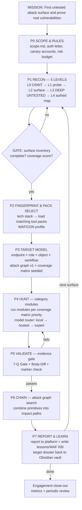

# Plan 4 — The Master Operating Plan

> The "plan of plans." Ties together: plan3 (31 bug modules + executor primitives), mind-hunt
> (doctrine + skills), PentAGI (orchestration patterns), and an **Obsidian vault as the AI
> context layer** (per the CXL context-layer model and the SSOT/filesystem-access model).
> Scope: authorized targets only — bug bounty programs, owned labs, contracted engagements.

---

# 1. Top-Down Diagram

The hierarchy: **Mission → Phases → Bug categories → Recon level → Hunting method → Tools →
Payloads → Validation → Knowledge capture.** Nothing is hunted before its recon prerequisite
is met; nothing is reported before its validation gate is passed; nothing is learned unless it
is written back to the vault.



The one-line rule that governs everything:

> **Recon feeds the model, the model feeds the hunt, evidence gates the finding,
> the vault feeds the next run.**

---

# 2. Recon Levels — "Endpoints Nobody Has Tested"

Recon is the highest-leverage phase. The difference between a duplicate report and a fresh
finding is almost always **surface nobody else enumerated**. Five levels, run in order; each
level's output feeds the next. The differentiator is **L3 — deep untested surface**.

## L0 — Passive OSINT (zero target contact)
| Activity | Tools | Output |
|---|---|---|
| Certificate transparency | crt.sh, ct logs | subdomain superset |
| Passive DNS enumeration | subfinder (passive), amass intel, whoxy | asset list |
| Code & secret leaks | github dorks, trufflehog, gitleaks | creds, internal hostnames, endpoints |
| Historical URLs | gau, waybackurls, commoncrawl index | **old/dead/unreferenced URL corpus** |
| Acquisition & subsidiary mapping | OSINT, crunchbase, certificate org names | expanded scope candidates |
| Employee/tech intel | theHarvester, wappalyzer passive | email format, stack hints |

## L1 — Semi-passive probe (looks like a normal visitor)
| Activity | Tools | Output |
|---|---|---|
| DNS resolution + liveness | dnsx, httpx | live host:port matrix |
| Tech fingerprint | wappalyzer, httpx tech-detect, whatweb | **stack list → §4 pack selection** |
| WAF/CDN profile | wafw00f, header/cookie analysis | WAF profile note → vault |
| TLS audit | sslyze, testssl.sh | cert SANs (more hostnames), weak TLS |
| robots/sitemap/security.txt | curl | disallowed paths (tested last by others — test FIRST) |

## L2 — Active surface discovery
| Activity | Tools | Output |
|---|---|---|
| Directory/endpoint brute | ffuf, dirsearch (recursion, calibrated wordlists) | endpoint inventory |
| JS bundle mining | LinkFinder, katana, jsfinder + custom extractor | **API routes, hidden params, secrets** |
| Parameter discovery | arjun, Param Miner (Burp) | hidden/unkeyed params |
| Port scan (in-scope hosts) | nmap (service + version) | service map |
| Content diff-ing | diff_probe-style calibration | what 404s really mean here |

## L3 — DEEP UNTESTED SURFACE (the differentiator)
This is where "endpoints nobody has ever tested" live. Prioritize by a
**testedness score** (lower = fresher):

| Source of fresh surface | How |
|---|---|
| Historical archive delta | wayback/gau URLs with `!live` — endpoints that existed, then vanished from the UI but may still resolve |
| JS source maps | `.map` files left in prod → original source, internal routes, feature flags |
| Unreferenced modern endpoints | present in JS bundles but never linked in UI (feature-flagged, admin, internal) |
| Old API versions | `/api/v1/` beside `/api/v3/` — v1 often lost its auth middleware |
| Mobile app backends | APK/IPA static analysis → hidden API endpoints (mobile apps pin old APIs) |
| GraphQL introspection | full schema dump → every query/mutation/type (better than any crawl) |
| Pre-prod/staging naming | dev/stage/uat/preprod/sandbox subdomains that resolve (L1 output) |
| Acquisition assets | bought companies keep old stacks alive for years |
| Batch/export/report/restore | unlinked sibling endpoints of visible features |
| Webhooks & callbacks | documented in API docs, never linked anywhere |

**Testedness score** per endpoint: `age (older=less tested) + obscurity (unlinked=less tested)
+ version_delta + auth_required (auth'd surfaces are 10x less tested) + parameter_depth`.
Sort the coverage matrix by this score before P4.

## L4 — Authenticated mapping (canary accounts only)
| Activity | Output |
|---|---|
| Role × endpoint walk (each canary role) | auth matrix |
| Object ID harvesting (every response) | object graph (IDs, types, owners) |
| Workflow tracing (signup → … → admin) | state machines for business-logic module |
| Response field audit per role | PII exposure baseline (H2 module) |
| Token/cookie lifecycle observation | session model for auth modules |

**Validation gate after recon (P1V):** endpoint inventory has live/unlive status, every live
endpoint has a testedness score, stack fingerprint complete, coverage matrix seeded, WAF
profile saved to vault. No hunting until this gate passes.

---

# 3. Bug Categories × Recon Level × Hunting Method

Every category from mind-hunt mapped to its **recon prerequisite**. You cannot hunt a
category without its recon level — this table is the sequencing law.

| # | Category (plan3 module) | Min recon | Hunting method (short) | Key tools |
|---|---|---|---|---|
| 1 | IDOR / BOLA (C1) | **L4** | role×object×endpoint matrix, body-diff, alt surfaces (export/report/restore) | http executor, 2 canary accounts |
| 2 | GraphQL IDOR (C2) | L2+schema | node() probing, field-level authz, batching | graphql client |
| 3 | Mass assignment (C3) | L4 | add privileged fields to every write endpoint | http executor |
| 4 | Broken auth / sibling rule (B1) | L2 | find unguarded siblings, method swap, old versions | ffuf, http executor |
| 5 | ATO 5 paths (B2) | L4 | reset poisoning, token lifecycle, email-change w/o reauth | http executor, canary mail |
| 6 | MFA bypass (B3) | L4 | OTP entropy/reuse/race, response tampering, skip params | burst executor |
| 7 | OAuth/OIDC (B4) | L2 | PKCE/state/redirect_uri matrix (11 bypasses), code interception | browser + http |
| 8 | SAML/SSO (B5) | L2+ | XSW variants, signature strip, NameID injection | XML lab (lxml) |
| 9 | SQLi (A1) | L2 | canary boolean/time/OOB per param, bisection on block | sqlmap (scoped), http, OOB server |
| 10 | XSS all forms (A2) | L2 | context detection → payload class → DOM proof | browser executor, payload packs |
| 11 | SSTI (A3) | L2 | detection matrix → engine fingerprint → escalate | http executor |
| 12 | XXE (A4) | L2 | XML/SVG/DOCX parse targets → OOB canary | OOB server, multipart |
| 13 | RCE/command (A5) | L2 | time/OOB canaries only, never destructive | OOB server |
| 14 | SSRF (E1) | L2 | URL params, 11 IP bypass forms, metadata ladder | OOB server |
| 15 | Race conditions (D2) | L4 | burst executor on check-then-act invariants | burst executor |
| 16 | Business logic (D1) | **L4** | state-machine illegal transitions, negative values, webhook trust | http, burst, LLM reasoning |
| 17 | File upload (H1) | L2 | extension/MIME/magic/polyglot matrix, SVG-XSS | multipart executor |
| 18 | CSRF (F1) | L4 | token enforcement, SameSite, JSON-CSRF | browser |
| 19 | CORS (E6a) | L1 | reflected origin + credentials, null origin | curl/http |
| 20 | Prototype pollution (E6b) | L2 | server merge gadgets, client check | browser, http |
| 21 | JWT/API misconfig (E6c) | L2 | alg confusion, weak secret, kid injection | jwt tools |
| 22 | HTTP smuggling (E2) | L2+WAF profile | CL.TE/TE.CL timing, own-session poison | **raw socket executor** |
| 23 | Cache poisoning/deception (E3) | L2+CDN profile | unkeyed param mining, cache-deception paths | Param-Miner-style, http |
| 24 | Subdomain takeover (E4) | **L1** | dangling CNAME + fingerprint table | dnsx, nuclei takeovers |
| 25 | Cloud misconfig (E5) | L1/L2 | bucket perms, Firebase rules, exposed panels | aws/gcp CLI, curl |
| 26 | LLM/AI features (G) | L2 | injection→IDOR-via-chatbot, markdown exfil, tool exfil | http, canary server |
| 27 | PII exposure (H2) | L4 | response field audit per role, exports, errors | observer |
| 28 | Clickjacking (F2) | L1 | framing test on sensitive pages | browser |
| 29 | Info/NTLM/stack (I1–I3) | L1 | stack-specific checks per pack | pack tools |

**Sequencing law:** L1 classes (24, 25, 28, 19) run first — cheapest, no auth, fast wins.
L2 injection classes next. L4 classes (1, 3, 5, 6, 15, 16, 18, 27) only after authenticated
mapping exists.

---

# 4. Tech-Stack Tool Packs (fingerprint → tools → attacks)

Recon fingerprint (P2) selects packs. Pack = tool list + attack checklist + payload set +
report notes. Stored in vault (`30-Bug-Classes` + `70-Tools`), loaded into agent context
when fingerprint matches.

| Stack fingerprint | Pack: tools & attacks |
|---|---|
| **WordPress** (`wp-content`, `wp-json`) | wpscan (plugin/theme/user enum, vulnerable plugin db) · `/wp-json/wp/v2/users` user leak · xmlrpc.php: `system.multicall` auth bypass/brute amplification, `pingback.ping` SSRF · wp-login brute (lockout-aware) · plugin-specific CVE lookup (wpvulndb) · `/?author=1` ID enumeration · theme/plugin file editor check · REST API authz gaps · object injection in legacy plugins (`maybe_unserialize`) |
| **Drupal** (`/sites/default/`) | droopescan · Drupalgeddon checks (version-dependent) · `/user/login` enum · module disclosure · config export dirs |
| **Joomla!** (`/components/`) | joomscan · version disclosure `/administrator/manifests/files/joomla.xml` · component CVE matching |
| **Shopify** | Shopify admin API checks, `/products.json` mass leak, app proxy misconfig, script tag injection (scoped) |
| **Rails** (`X-Request-Id`, Rack headers) | mass assignment (`update(req.body)`), RoR secret disclosure, parameter pollution, Rack CRLF |
| **ASP.NET** (`X-AspNet`, `__VIEWSTATE`) | ViewState MAC/enc check, Trace.axd, elmah.axd, padding oracle (report only), `X-Powered-By` version → CVE match |
| **Java/J2EE** (`JSESSIONID`) | deserialization gadgets (report), `/manager` exposure, struts/tiles CVE match, Spring actuator endpoints (`/env`, `/heapdump`) |
| **Node/Express** (`X-Powered-By: Express`) | prototype pollution gadgets, `__proto__` params, SSRF in axios/got, NPM package audit of client bundles |
| **PHP** (`X-Powered-By: PHP`) | version-match CVEs, `phpinfo()` exposure, file-inclusion patterns, serialization magic methods |
| **GraphQL** (`/__graphql`) | introspection dump → schema → node() IDOR, batching, field suggestions, depth abuse (report only) |
| **AWS** (S3/ARN headers) | bucket perms, `169.254.169.254` via any SSRF, Cognito misconfig, Lambda env leak |
| **Azure/M365** (`.onmicrosoft.com`) | illicit consent grant, Graph API scope audit, Azure AD enum (pack: m365-entra) |
| **Okta/Auth0** | Okta API token flows, SSA apps, auth0 rules (pack: okta-attack) |
| **SharePoint** (`_layouts`) | `download.aspx?SourceUrl=` handling + extension-blocklist false-oracle awareness |
| **vCenter/vSphere** (`:9443`) | known CVE surface (verify-version + report, no exploit relay) |
| **VPN appliances** (pulse/fortinet/ivanti/citrix) | version → CVE match, default-cred check on canary only (pack: enterprise-vpn) |
| **Kubernetes** (`/api/v1`, k8s headers) | anonymous API access, etcd/dashboard exposure, metadata service chain |
| **Cloudflare/CDN** | origin IP discovery (historical DNS, cert SANs, misdirected subdomains), cache-key behavior, WAF profile build |

Each pack in the vault carries: `tools` (exact commands), `attacks` (checklist), `payloads`
(link to `40-Payloads` notes), `evidence format` (what a valid finding looks like),
`false-positive warnings`.

---

# 5. Payload Supply Chain

Where payloads come from, in priority order:

| Source | What | Storage |
|---|---|---|
| **Static wordlists** | SecLists (dirs, params, usernames), fuzzdb | `tools/wordlists/` (git-cloned, version-pinned) |
| **Curated payload repos** | PayloadsAllTheThings (per-class), PortSwigger XSS cheat sheet, payloadbox | `40-Payloads/` vault notes, per-class, linked to bug-class notes |
| **mind-hunt arsenal** | xss-paracyberbellum (469 evasion-tagged payloads), diff_probe grammar variants | already in `mind-hunt/arsenal/` — symlink into vault |
| **Live generation** | local 30B: mutations of known-blocked payloads; hosted: novel bypasses with reasoning | `payload_genes` table (traits, success/failure counts) |
| **Harvested** | what actually worked — extracted from confirmed findings and lesson cards | `payload_genes` + vault `50-WAF-Bypasses/` |

**Payload lifecycle:**
1. Candidate enters the pool (static import / LLM generation / harvest).
2. **Pre-use validation** — deterministic checks: matches target context class, length within
   bounds, canary marker present, no destructive tokens (DML/DDL, `rm`, etc. — per plan3
   safety rules). Invalid candidates never reach the executor.
3. Fired → observation recorded → gene success counters updated (bandit selection next run).
4. Blocked payloads → bisection → mutated variants become new genes.

**Canary markers:** every generated payload embeds `canary_<class>_<8-char-rand>`; markers are
checked against the no-marker baseline before any reflection claim (marker discipline).

---

# 6. Storage Architecture — Three Tiers

| Tier | Tech | What lives there | Write path |
|---|---|---|---|
| **1. Raw evidence** | PostgreSQL (JSONB) + object store (screenshots, .har, response bodies > threshold) | every request/response pair, observation vectors, tool stdout/stderr, callback hits — immutable, append-only | Executor/Observer write directly; never edited, only superseded |
| **2. Operational DB** | PostgreSQL | endpoints, objects, roles, attack graph edges, findings (lifecycle states), payload genes, WAF KB, coverage matrix | Classifier/agents write via validated actions |
| **3. Obsidian vault** | plain Markdown, **git-versioned** | the human+AI knowledge base: target dossiers, WAF profiles, lessons, playbooks, reports | Session-close process writes back (§7.3); AI agents read/write files directly (no API needed) |

Division of labor: Tier 1/2 = machine-fast operational state; Tier 3 = compounding knowledge.
PentAGI's pattern (msgchains/toolcalls/termlogs tables + pgvector chunks) is the reference
implementation for Tiers 1–2 if we build on PentAGI.

---

# 7. Obsidian Vault Design (the AI context layer)

Applying the two articles' principles: **plain markdown on disk** (AI needs no API — just
filesystem access), **bi-directional links** (implicit knowledge graph), **SSOT** (one place,
everything links), **git versioning** (every AI change reversible), **cherry-picked context**
(load only what the task needs).

## 7.1 Vault structure

```
bugvault/
├── 00-Engine/                     # THE AI CONTEXT LAYER — loaded by agents
│   ├── doctrine.md                # hunting doctrine (marker discipline, body-diff, 7-Q gate)
│   ├── model-routing.md           # §8 routing table, fallback rules
│   ├── scope-template.md          # per-campaign scope skeleton
│   └── agent-prompts/             # system prompts per agent role
├── 10-Campaigns/
│   └── <campaign-name>/
│       ├── scope.md               # THE authority: in/out, rules, canaries, budget
│       ├── campaign.md            # MOC note — links to everything below
│       ├── recon.md               # surface inventory + testedness scores
│       ├── attack-graph.md        # rendered graph snapshot per phase
│       ├── coverage.md            # live coverage matrix (dataview query)
│       └── findings/              # one note per finding (templated)
├── 20-Targets/
│   └── <target>/
│       ├── dossier.md             # stack, WAF profile, quirks, rate limits
│       └── history.md             # past campaigns, what worked/failed
├── 30-Bug-Classes/                # one note per class, linked to playbooks+payloads
│   ├── idor-bola.md  sqli.md  xss.md  ssti.md  xxe.md  ssrf.md
│   ├── oauth.md  saml.md  mfa-bypass.md  ato.md
│   ├── race-conditions.md  business-logic.md  file-upload.md
│   ├── smuggling.md  cache-poisoning.md  subdomain-takeover.md
│   ├── cloud-misconfig.md  graphql.md  llm-ai.md  csrf.md  cors.md ...
├── 40-Payloads/                   # curated per class, links to sources
├── 50-WAF-Bypasses/               # per-WAF profile: blocked patterns → working bypasses
├── 60-Lessons/                    # lesson cards (anonymized, one lesson per note)
├── 70-Tools/                      # tool notes: usage, output format, quirks, pack lists (§4)
├── 80-Reports/                    # submitted reports + platform responses (dup/N-A/accepted)
└── 90-Meta/
    ├── metrics.md                 # per-campaign stats, updated at close
    └── reviews/                   # periodic reviews — what to change in doctrine/packs
```

## 7.2 The linking law

Every note links up and down: a finding links to its bug-class note, target dossier, payload
notes, and evidence IDs. A lesson links to the WAF profile and classes it affects. This is
what makes the vault a graph the AI can traverse — "find everything we know about Cloudflare
WAF + SQLi" is a two-hop link query, not a search.

## 7.3 The three background processes (per the CXL/Kieran Flanagan model)

1. **Session start — load context:** agent reads `scope.md` + campaign MOC + the bug-class
   notes for the categories queued this session + target dossier + relevant WAF profile +
   top lesson cards. No session ever starts cold.
2. **Mid-session — save state:** observations/coverage changes written to operational DB
   continuously; a session summary note is appended if context runs long (anti-drift, same
   pattern as mind-hunt's anti-drift hooks).
3. **Session close — capture decisions:** findings finalized, lesson cards written, WAF KB
   updated, target dossier enriched, `metrics.md` updated. **Context compounds instead of
   resetting.**

## 7.4 "Nothing untested" as a live vault query

The coverage matrix is a first-class note. With Dataview/Bases, `coverage.md` renders:
endpoints × categories with status (`untested / queued / tested / confirmed / refuted /
n-a`), sorted by testedness score. The engagement is not closed while any in-scope
endpoint×category combination that applies to its stack is `untested`. This turns "make sure
nothing goes untested" from a hope into a query.

---

# 8. Model-Switching Agent Layer

One router, per-task primary + fallback chain, health-tracked. Built on PentAGI's per-agent
config pattern (13 agent slots) but with **cross-provider routing** (PentAGI's main gap).

| Task class | Primary | Fallback 1 | Fallback 2 |
|---|---|---|---|
| Parse response / classify obvious | Local 30B | — | — |
| Next-action / hypothesis generation | Local 30B | Hosted | — |
| Payload mutation (hot loop) | Local 30B | Hosted | — |
| WAF bypass strategy | Hosted | Local | Claude (high-value) |
| Business-logic / state-machine reasoning | Hosted | Claude | — |
| IDOR/BOLA matrix planning | Hosted | Claude | — |
| GraphQL schema analysis | Hosted | Claude | — |
| Exploit/PoC code generation | Codex | Local coder model | — |
| PoC review / plausibility | Claude | Codex | — |
| Report writing | Claude | Hosted | — |
| Chain planning | Hosted | Claude | — |
| Prompt-refusal recovery | Local (uncensored) | Hosted (rephrased) | — |

**Fallback rules (deterministic, not model-decided):**
1. JSON schema validation fails → 1 retry with error feedback → next in chain.
2. Timeout / rate limit → next in chain, mark degraded, continue.
3. Refusal → technical rephrase → next in chain.
4. Provider health tracker: 3 consecutive failures → deprioritize for 15 min.
5. Cost cap per campaign (defined in `scope.md`); router refuses to escalate when cap hit
   unless operator approves.

---

# 9. Sequence, Requirements, Validation Gates

## 9.1 Phase sequence & per-phase validation

| Phase | Output | Validation gate (must pass to proceed) |
|---|---|---|
| P0 Scope | scope.md | every allowed host resolves to explicit entries; canary accounts verified working; risk budget set |
| P1 Recon L0–L3 | surface inventory + testedness scores | every live endpoint has score + stack tag; untested-surface list produced; no in-scope host unprobed |
| P2 Fingerprint | stack list, WAF profile, pack selection | every detected stack maps to a pack; WAF profile saved to vault |
| P3 Mapping (L4) | auth matrix, object graph, state machines | every role can access its own objects; object types inventoried; coverage matrix seeded with ALL endpoint×category rows |
| P4 Hunt | observations per module | per-module exit: every queued (endpoint, category) row has status ≠ untested; blocked rows have WAF analysis attached |
| P5 Validate | confirmed/rejected findings | 7-Q gate PASS on each confirmed; body-diff shown; marker verified |
| P6 Chain | chained findings | each chain step evidence-linked; human approval for L3 autonomy actions |
| P7 Report & learn | reports + KB updates | platform response logged; lesson cards written; vault committed to git |

## 9.2 Requirements

**Infra:** VPS or local Docker host (PentAGI-style stack if adopted), canary/OOB server
(Interactsh self-hosted or custom), domain for callbacks, 2+ canary accounts per role on
target, Burp (manual verification), git repo for the vault.

**Models:** local 30B (Ollama/vLLM), one hosted API (DeepSeek), Claude Max + Codex Max as
escalation layer. If adopting PentAGI: 110K-context requirement → DeepSeek primary is the
pragmatic choice; local for utility agents after cross-provider routing is added.

**Tools base:** subfinder, amass, httpx, dnsx, ffuf, gau/waybackurls, katana, LinkFinder,
arjun, nmap, nuclei, wpscan/droopescan/joomscan (pack tools), sqlmap (scoped), Playwright,
jwt tools, interactsh, hashcat (canary-hash only).

**Data:** PostgreSQL + pgvector, git, Obsidian.

## 9.3 Engagement close-out checklist

1. Coverage query returns zero `untested` applicable rows.
2. All findings in `report_ready` state have evidence pairs archived (Tier 1).
3. Lesson cards + WAF KB updated; target dossier enriched; `metrics.md` filled
   (TP/FP, time-to-finding, requests, cost, human overrides).
4. Vault committed; periodic review scheduled (90-Meta) — doctrine and packs get better
   every engagement.

---

# 10. The Loop, Restated

```
scope → recon (L0→L4, hunt the untested) → fingerprint → packs → model
→ hunt by category matrix → evidence gate → chain → report
→ write EVERYTHING back to the vault → next run starts smarter
```

The vault is the flywheel. Every campaign ends with the knowledge base strictly larger and
better linked than before — that compounding is the whole design.
